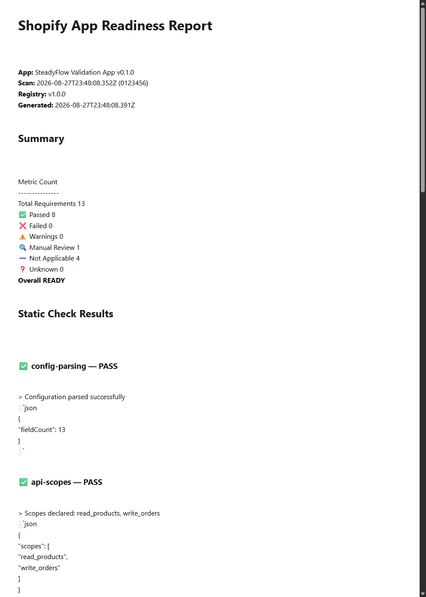

# SteadyFlow

> An auditable, multi-platform **Shopify revenue-optimization platform**.

[](https://github.com/sgm-audio/steadyflow/actions/workflows/ci.yml)
[](https://github.com/sgm-audio/steadyflow/actions/workflows/release.yml)


SteadyFlow runs a **200-point Shopify Revenue Leak Audit** against a merchant store, then surfaces a ranked, evidence-backed fix plan. Shopify Admin GraphQL + Printify costs are the primary live data path; Supabase (Postgres + RLS + Edge Functions) is the single source of truth.

- **Primary platforms:** Shopify + Printify (fulfillment)
- **Status:** v0.x internal pilot (not yet public v1.0.0)
- **Validation account:** Making Madi



---

## What it does

| Module | What it produces |
|--------|------------------|
| **Catalog audit** | Per-product margin, SEO, inventory, conversion flags via Shopify Admin GraphQL (paginated, schema-validated) |
| **Revenue Leak List** | Ranked recoverable-revenue estimate per finding |
| **Performance signals** | PSI lab + CrUX field data (LCP / CLS), wired into insights |
| **Theme lint** | Static HTML proxy for Online Store 2.0 theme-check rules |
| **App fingerprints** | Detects third-party storefront apps + sitemap-aware crawl, deduped over time |
| **Tracking verification** | GA4 / GTM / Meta / TikTok / Klaviyo / etc. — weighted coverage score |
| **Score history** | Rubric-graded (A–F) snapshots per audit → recurring diff view |
| **App readiness** | Shopify App Store requirement scan (static checks + manual review) |

## Architecture

```
┌─────────────────┐  ┌─────────────────┐
│ Chrome MV3 ext. │  │ Web Dashboard   │
│ (experimental)  │  │ (ops view)      │
└────────┬────────┘  └────────┬────────┘
         │                   │
         └─── @steadyflow/core (TS, shared) ──┘
                          │
                          ▼
                Supabase (single source of truth)
                ├── Postgres + RLS (every table)
                ├── Auth · Storage · pgmq (queues)
                └── Edge Functions (BFF + workers)
                          │
        ┌─────────────────┼─────────────────┐
        ▼                 ▼                 ▼
   Firecrawl          Tavily           LLM (BYOK)
```

## Repo layout

```
steadyflow/
├── apps/
│   ├── edge/          # Supabase Edge Functions (BFF + workers)
│   ├── web/           # Next.js dashboard
│   ├── desktop/       # Tauri v2 shell — EXPERIMENTAL
│   └── extension/     # Chrome MV3 capture — EXPERIMENTAL
├── packages/
│   ├── core/          # Zod schemas, audit hashing, crypto, contract definitions ← START HERE
│   ├── db/            # Generated Supabase types
│   ├── llm/           # LLM adapter pattern (OpenAI-compatible)
│   ├── shopify-admin/ # Shopify Admin GraphQL + Printify cost audit
│   └── commerce/      # Multi-platform adapters (Shopify/Printify live)
├── supabase/          # migrations, functions (Deno), scripts
├── tooling/devkit/    # Shopify + WordPress scaffolding CLI
└── turbo.json
```

> Removed and not to be referenced: `packages/crypto/` (→ `core/src/crypto/`), `packages/sdk/`, `packages/contracts/` (→ `core/src/contracts/`).

## Shopify Admin API

Queries live in `packages/shopify-admin/src/shopify/queries.ts`, validated against **Admin GraphQL 2026-07** and executed by `ShopifyClient` (retry + throttle backoff + client-credentials token cache).

The catalog query is modernized to 2026-07 (no deprecated fields):
`publicDisplayName` · `shopAddress` · `featuredMedia.preview.image` · `media { ... on MediaImage }`.

**Required scopes** (broadened by the `media` union): `read_products`, `read_files`, `read_images`, `read_themes` (+ `read_orders` when sales summary is enabled). The merchant grant / collaborator request must include these.

## Contracts (the API surface)

Procedure definitions live in `packages/core/src/contracts/procedures.ts`. The `Router` type in `router.ts` is the single source of truth — 12 procedures: `intel.analyzeShop`, `intel.trackingCheck`, `insights.list`, `audit.query`, `keys.set`, `keys.list`, `keys.test`, `org.llmConfig.get`, `org.llmConfig.set`, `intent.cancel`, `intent.list`, `report.generate`.

Every procedure declares `auth`, `rateLimit`, `idempotent`. Every input/output is `z.strictObject` / `.strict()` — unknown keys are rejected.

## Setup

Requires Node 20+, pnpm 9, Docker Desktop, Supabase CLI.

```bash
git clone https://github.com/sgm-audio/steadyflow.git
cd steadyflow
pnpm setup      # install deps, create .env.local, run doctor
pnpm dev        # Supabase + workers + web (http://127.0.0.1:3000)
pnpm stop       # stop local Supabase
```

| Command | Purpose |
|---------|---------|
| `pnpm setup` | First-time (or repair) bootstrap |
| `pnpm doctor` | Verify Node / pnpm / Docker / Supabase CLI |
| `pnpm dev` / `pnpm stop` | Start / stop local stack |
| `pnpm check` | Pre-PR gate: typecheck + lint + test |
| `pnpm typecheck` / `pnpm lint` / `pnpm test` | Individual checks |
| `pnpm build` | Turbo build (all packages) |
| `pnpm contract` | Verify contract definitions |
| `pnpm vendor:shopify-admin` | Regenerate Deno-vendored shopify-admin bundle |
| `pnpm scaffold:shopify-theme ./path` | Scaffold Online Store 2.0 theme |
| `pnpm scaffold:shopify-app ./path` | Scaffold Shopify app |
| `pnpm scaffold:wp-plugin ./path` / `:wp-theme ./path` | Scaffold WordPress |

Local seed login: `dev@steadyflow.local` / `admin`. Studio: http://127.0.0.1:54323.

## Testing

- Vitest, node environment, tests co-located as `*.test.ts`
- Coverage thresholds: **90%** statements/functions/lines, **85%** branches
- Single package: `pnpm --filter @steadyflow/core test` · single file: `npx vitest run packages/core/src/result.test.ts`
- `apps/edge` integration tests need a local Supabase + `SUPABASE_SERVICE_ROLE_KEY` (fail closed when absent)

## CI / CD

- **`.github/workflows/ci.yml`** — on every push/PR to `main`: typecheck + lint + test, Gitleaks secret scan, dependency audit; on `main` push, deploys Supabase Edge Functions when `SUPABASE_ACCESS_TOKEN` + `SUPABASE_PROJECT_REF` secrets are set.
- **`.github/workflows/release.yml`** — on `v*` tags: full `pnpm check`, then creates a GitHub Release with auto-generated notes.

Tags follow SemVer: `v0.1.0`, `v0.2.0`, … Create with `git tag v0.1.0 && git push origin v0.1.0`.

## Security & audit

- **BYOK** — provider keys wrapped with a per-org DEK (Argon2id), unwrapped per-request via `pgsodium`, buffers zeroed. Plaintext keys are never stored at rest.
- **Audit** — every external action writes to append-only `audit_log` (`user_id`, `timestamp`, SHA-256 input hash, `outcome`, `provider`, `action`, `duration_ms`). UPDATE/DELETE blocked except by `service_role`.
- **RLS** on every table · OS keychain · Firecrawl primary, Playwright secondary · Tavily for enrichment (Hunter.io removed).

## Commit convention

Conventional Commits (`feat:`, `fix:`, `chore:`, `docs:`, `refactor:`, `test:`, `ci:`). Branch from `main` as `feat/<scope>`.

## License

UNLICENSED — proprietary.
